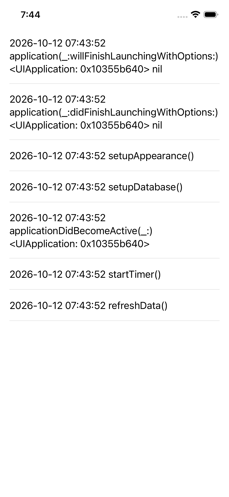
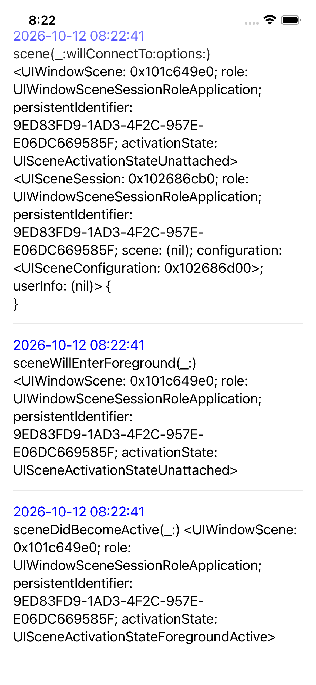
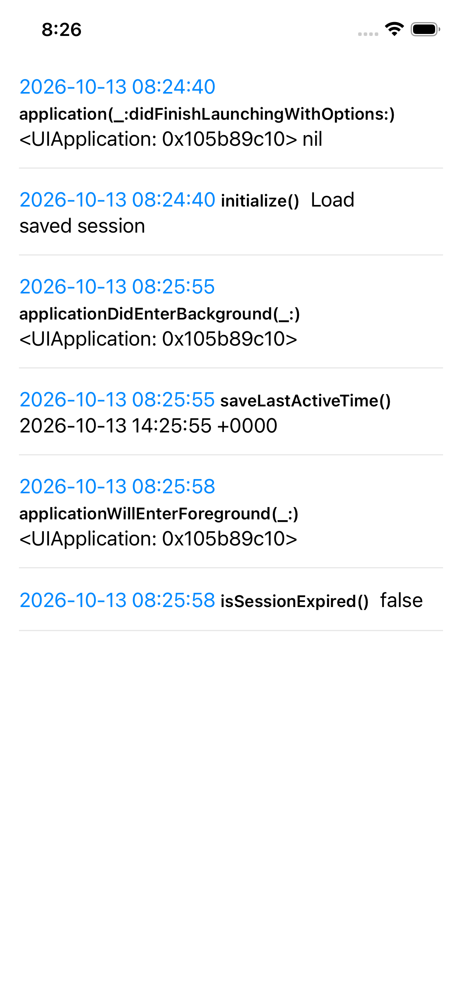

# iOS Interview

Topics: [github.com/mukundjogi/ios-interview](https://github.com/mukundjogi/ios-interview)

## iOS Basics
### iOS App Lifecycle

<table>
  <tr valign="top">
    <td>
        
    </td><td>
      iOS Basics:
      <a href="https://github.com/mukundjogi/ios-interview/blob/main/docs/ios-basics.md#app-delegate-methods">App Delegate Methods</a>  
      Code:
      <a href="iOSBasics/iOSAppLifecycle/AppDelegateMethods/AppDelegateMethods/AppDelegate.swift">AppDelegate.swift</a>
    </td>
  </tr>
  <tr valign="top">
    <td>
        
    </td><td>
      iOS Basics:
      <a href="https://github.com/mukundjogi/ios-interview/blob/main/docs/ios-basics.md#scene-based-lifecycle-ios-13">Scene Based Lifecycle</a>  
      Code:
      <a href="iOSBasics/iOSAppLifecycle/SceneBasedLifecycle/SceneBasedLifecycle/SceneDelegate.swift">SceneDelegate.swift</a>
    </td>
  </tr>
    <tr valign="top">
    <td>
        
    </td><td>
      iOS Basics:
      <a href="https://github.com/mukundjogi/ios-interview/blob/main/docs/ios-basics.md#practical-example-managing-user-session">Practical Example: Managing User Session</a>  
      Code:
      <a href="iOSBasics/iOSAppLifecycle/ManagingUserSession/ManagingUserSession/SessionManager.swift">SessionManager.swift</a>
    </td>
  </tr>
</table>
